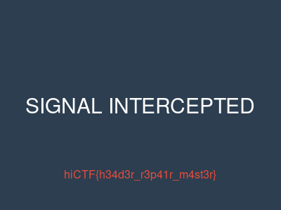

# Broken Signals

**Category:** Forensics (file repair)  **Flag:** `hiCTF{h34d3r_r3p41r_m4st3r}`

> Our signals intelligence team intercepted a file during a routine sweep, but it appears corrupted. The file cannot be opened by any standard application. Something is wrong with the file itself — can you repair it and recover the hidden message?

File: `broken-signals.zip` → `broken_signal.dat` (15,916 bytes)

## Solution

1. `xxd broken_signal.dat | head -1` shows

   ```
   00 00 00 00 0d 0a 1a 0a 00 00 00 0d 49 48 44 52 ...
   ```

   Bytes 4–7 (`0D 0A 1A 0A`) plus an `IHDR` chunk right after them mark this as a PNG. Only the first 4 bytes of the 8-byte signature have been zeroed. The correct value is `89 50 4E 47` (`\x89PNG`).
2. Write `89 50 4E 47` back into bytes 0–3.
3. Check that nothing else is damaged:
   - every chunk CRC is valid (IHDR, cHRM, bKGD, tIME, 3× tEXt, IDAT, IEND)
   - IHDR says 400×300, 16-bit RGBA, so the image data should be 300 × (1 + 400×8) = 960,300 bytes. The IDAT inflates to exactly that.
4. Open the repaired image. It reads **SIGNAL INTERCEPTED** with the flag printed in red below it.



## Files
- `solve/repair.py` patches the magic bytes, verifies every chunk CRC and the IDAT size, and writes the repaired PNG
- `artifacts/fixed.png` is the repaired image with the flag
- `artifacts/broken_signal_original.dat` is the original corrupted file
- `artifacts/solver_output.txt` is the chunk/CRC report
