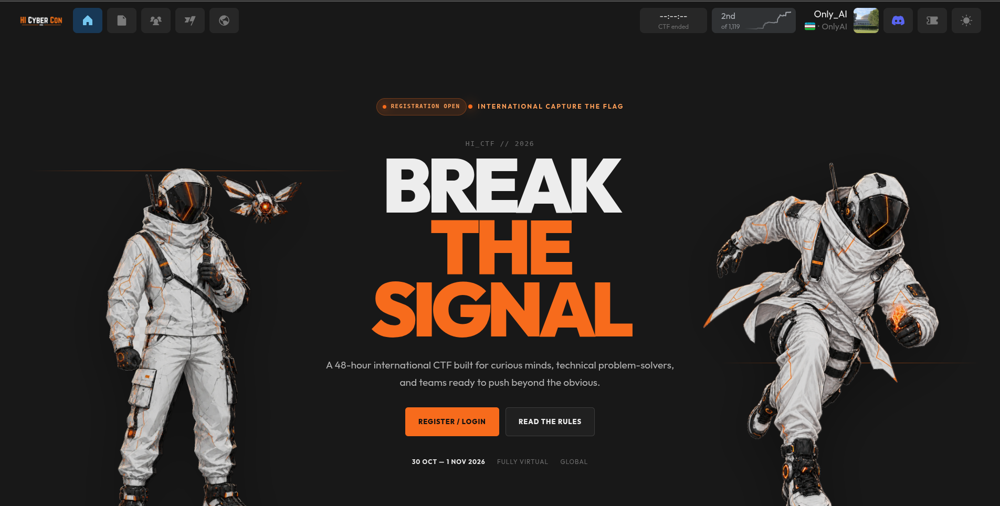
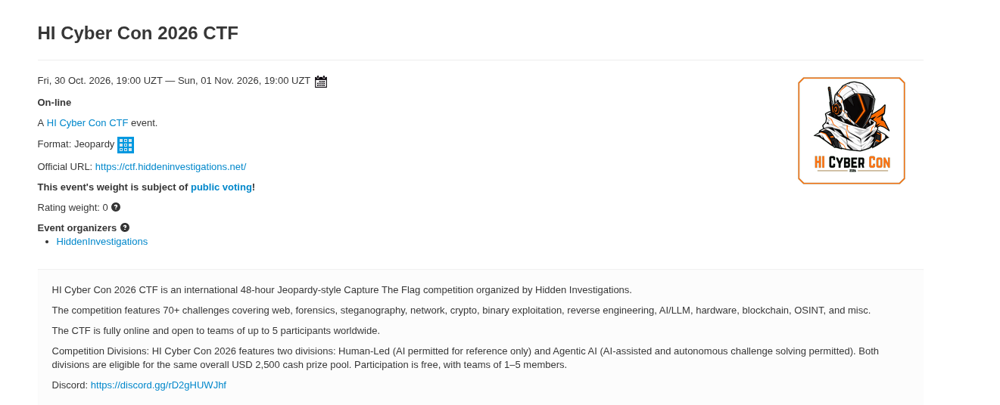

# HI Cyber Con 2026 CTF Writeups

### 🥈 2nd Place · Fr4ctur3 (Only_AI)

**48 hours. One scoreboard. A collection of what we learned.**

CTF writeups, challenge solutions, solver scripts, and forensic artifacts from **HI Cyber Con 2026 (HI CyberCon / HICyberCon)** by **Fr4ctur3 (Only_AI)**, second-place team.

[**Browse the checklist**](CHECKLIST.md) · [**Contributors**](CONTRIBUTORS.md) · [**Event website**](https://hicybercon.hiddeninvestigations.net/) · [**Discord**](https://discord.gg/rD2gHUWJhf)

---

## The result

We placed **2nd at HI Cyber Con 2026 CTF** as **Fr4ctur3 (Only_AI)**. The platform screenshot above shows **Only_AI ranked 2nd out of 1,119 teams**.

This repository brings together our challenge writeups, solver scripts, and supporting artifacts. We are adding writeups as they become ready so others can follow the reasoning, reproduce the techniques, and learn from the event.

## The event

[HI Cyber Con 2026](https://hicybercon.hiddeninvestigations.net/) was a fully virtual, international cybersecurity event organized by [Hidden Investigations](https://hiddeninvestigations.net/), with a 48-hour CTF alongside its conference programme.

| | Details |
| :--- | :--- |
| **Dates** | 30 October – 1 November 2026 |
| **CTF window** | 30 Oct, 14:00 UTC → 1 Nov, 14:00 UTC · 19:00 UZT → 19:00 UZT |
| **Format** | Online · Jeopardy-style · 48 hours |
| **Team size** | 1–5 participants |
| **Platform** | [ctf.hiddeninvestigations.net](https://ctf.hiddeninvestigations.net/) |
| **Our collection** | 69 challenges across 13 repository categories |

<strong>View the event listing</strong>

## Explore the writeups

**35 / 69 Markdown writeups uploaded.** The links below open each category. For every challenge and its upload status, use the [full checklist](CHECKLIST.md).

| Category | Writeups uploaded |
| :--- | :---: |
| 💥 [Binary Exploitation](./Binary%20Exploitation/) | **1 / 4** |
| 🧩 [Reverse Engineering](./Reverse%20Engineering/) | **4 / 10** |
| 🔐 [Cryptography](./Cryptography/) | **7 / 8** |
| 🔎 [Forensics](./Forensics/) | **3 / 7** |
| ⛓️ [Blockchain](./Blockchain/) | **1 / 5** |
| 🌐 [Web](./Web/) | **5 / 7** |
| 🗂️ [Miscellaneous](./Miscellaneous/) | **1 / 6** |
| 🛰️ [OSINT](./OSINT/) | **0 / 4** |
| 🤖 [AI / LLM](./ai-llm/) | **1 / 1** |
| 📱 [Android](./android/) | **1 / 2** |
| ⚙️ [Hardware](./hardware/) | **4 / 5** |
| 📡 [Network](./network/) | **1 / 2** |
| 🖼️ [Steganography](./steg/) | **7 / 8** |

> The Inner Engine has solver and evidence files uploaded; its Markdown writeup is pending. VaultKeeper's writeup retains its disputed-result note. Upload status records available documentation, not contest acceptance.

### Start here

- [The Coffee Shop](./Web/The%20Coffee%20Shop/The%20Coffee%20Shop.md) — PHP runtime exploitation and adapting the attack to the challenge proxy.
- [Rocinate Revenge](./Cryptography/Rocinate%20Revenge/Rocinate%20Revenge.md) — algebraic cryptanalysis, integer relations, and nonce recovery.
- [Operation Chimera](./network/Operation%20Chimera/Operation%20Chimera.md) — traffic investigation, extracted HTTP objects, and hidden exfiltration.
- [No Bit Sings Alone](./steg/No%20Bit%20Sings%20Alone/No%20Bit%20Sings%20Alone.md) — audio steganography and cryptography.

<strong>All 35 available challenge writeups</strong>

**Binary Exploitation**

- [Titan Relay](./Binary%20Exploitation/Titan%20Relay/Titan%20Relay.md)

**Reverse Engineering**

- [Cold Beacon](./Reverse%20Engineering/Cold%20Beacon/Cold%20Beacon.md)
- [Night Batch](./Reverse%20Engineering/Night%20Batch/Night%20Batch.md)
- [Obfuscated Flow](./Reverse%20Engineering/Obfuscated%20Flow/Obfuscated%20Flow.md)
- [Signal Lock](./Reverse%20Engineering/Signal%20Lock/Signal%20Lock.md)

**Cryptography**

- [Just Give Me The Flag Man](./Cryptography/Just%20Give%20Me%20The%20Flag%20Man/Just%20Give%20Me%20The%20Flag%20Man.md)
- [Cipher Cascade](./Cryptography/Cipher%20Cascade/Cipher%20Cascade.md)
- [Tyco](./Cryptography/Tyco/Tyco.md)
- [ChronoGrind](./Cryptography/ChronoGrind/ChronoGrind.md)
- [Rocinate](./Cryptography/Rocinate/Rocinate.md)
- [Cairn](./Cryptography/Cairn/Cairn.md)
- [Rocinate Revenge](./Cryptography/Rocinate%20Revenge/Rocinate%20Revenge.md)

**Forensics**

- [Ghost in the Wire](./Forensics/Ghost%20in%20the%20Wire/Ghost%20in%20the%20Wire.md)
- [Broken Signals](./Forensics/Broken%20Signals/Broken%20Signals.md)
- [Memory Liar](./Forensics/Memory%20Liar/Memory%20Liar.md)

**Blockchain**

- [Standing Order](./Blockchain/Standing%20Order/Standing%20Order.md)

**Web**

- [File Viewer](./Web/File%20Viewer/File%20Viewer.md)
- [Stillwell Estates](./Web/Stillwell%20Estates/Stillwell%20Estates.md)
- [Overgrowth](./Web/Overgrowth/Overgrowth.md)
- [Ouroboros](./Web/Ouroboros/Ouroboros.md)
- [The Coffee Shop](./Web/The%20Coffee%20Shop/The%20Coffee%20Shop.md)

**Miscellaneous**

- [Labyrinth](./Miscellaneous/Labyrinth/Labyrinth.md)

**ai-llm**

- [Blind Index](./ai-llm/Blind%20Index/Blind%20Index.md)

**android**

- [VaultKeeper](./android/VaultKeeper/VaultKeeper.md)

**hardware**

- [Tasmota Vault](./hardware/Tasmota%20Vault/Tasmota%20Vault.md)
- [GhostBus](./hardware/GhostBus/GhostBus.md)
- [C3 Vault](./hardware/C3%20Vault/C3%20Vault.md)
- [Ground Station](./hardware/Ground%20Station/Ground%20Station.md)

**network**

- [Operation Chimera](./network/Operation%20Chimera/Operation%20Chimera.md)

**steg**

- [Roof of Africa](./steg/Roof%20of%20Africa/Roof%20of%20Africa.md)
- [Zanzibar Whisper](./steg/Zanzibar%20Whisper/Zanzibar%20Whisper.md)
- [Whispers in the Margin](./steg/Whispers%20in%20the%20Margin/Whispers%20in%20the%20Margin.md)
- [Echoes of a Forgotten Canvas](./steg/Echoes%20of%20a%20Forgotten%20Canvas/Echoes%20of%20a%20Forgotten%20Canvas.md)
- [Paper Trail](./steg/Paper%20Trail/Paper%20Trail.md)
- [No Bit Sings Alone](./steg/No%20Bit%20Sings%20Alone/No%20Bit%20Sings%20Alone.md)

## Inside each challenge folder

Writeups use the **challenge name**, such as `The Coffee Shop.md`, rather than `README.md`. Depending on the supplied material, folders also include solver code, original challenge archives, extracted artifacts, screenshots, and verification output.

Some folders currently contain only a `.gitkeep` placeholder. They are ready for future writeups; the [checklist](CHECKLIST.md) tracks what is available.

## Team & contributors

**Fr4ctur3 (Only_AI)** · Thank you to everyone who shared solutions, scripts, and writeups.

| | GitHub |
| :--- | :--- |
| Repository maintainer | [ushoxa](https://github.com/ushoxa) |
| Contributors | [tinhatinh](https://github.com/tinhatinh) · [shodmonovvx](https://github.com/shodmonovvx) · [Isroilov-Sardor](https://github.com/Isroilov-Sardor) · [ortikovs](https://github.com/ortikovs) |

See [CONTRIBUTORS.md](CONTRIBUTORS.md) for the contributor list. Individual writeups preserve their supplied author credits.

## Official links & community

Explore the event and connect with **Hidden Investigations** through the links published on its official websites.

| | Links |
| :--- | :--- |
| **Event** | [HI Cyber Con 2026](https://hicybercon.hiddeninvestigations.net/) · [CTF overview](https://hicybercon.hiddeninvestigations.net/ctf) · [Challenge platform](https://ctf.hiddeninvestigations.net/) |
| **Community** | [Discord](https://discord.gg/rD2gHUWJhf) · [Community page](https://hiddeninvestigations.net/community) |
| **Socials** | [LinkedIn](https://www.linkedin.com/company/hiddeninvestigations) · [X / Twitter](https://x.com/hisecuritylab) · [Facebook](https://www.facebook.com/hiddeninvestigations) |
| **Code & CTF** | [GitHub](https://github.com/Hidden-Investigations) · [CTFtime team](https://ctftime.org/team/188318) |
| **Organizer** | [Hidden Investigations](https://hiddeninvestigations.net/) · [Contact](https://hiddeninvestigations.net/contact) · [hi@hiddeninvestigations.net](mailto:hi@hiddeninvestigations.net) |

## Contribute a writeup

Have a missing HI Cyber Con 2026 solution or a correction? Open a pull request with your writeup in the matching challenge folder, name the file after the challenge, and keep your author credit. Include reproduction steps and supporting files when available. Update [CHECKLIST.md](CHECKLIST.md) and the progress counts when adding a new writeup.

If this collection helps you, consider starring it or sharing a useful challenge writeup with the CTF community.

## Acknowledgments

Thank you to Hidden Investigations, the organizers, challenge authors, and the wider CTF community for the competition. The event artwork and screenshots above belong to their respective owners; this is our team's writeup collection.

---

**Break the signal. Share the solution.**

[Back to top](#hi-cyber-con-2026-ctf-writeups)

