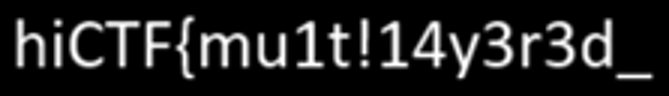
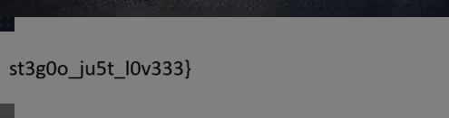

# Echoes of a Forgotten Canvas

**Category:** Steganography (multi-layer)  **Flag:** `hiCTF{mu1t!14y3r3d_st3g0o_ju5t_l0v333}`

> A seemingly ordinary file has surfaced with traces of something unusual. It may look complete at first glance, but appearances can be deceiving. Explore the artifact carefully and uncover what was left behind.

File: `echoes-of-a-forgotten-canvas.zip` → `chall.png` (8.9 MB)

## Solution: four layers

### Layer 1: PNG height trick → first half of the flag
- PIL refuses to open `chall.png`, and the IHDR CRC doesn't match the header (`ee7fe302` computed vs `4675412a` stored).
- IHDR claims **4000×4000**. Brute-forcing the height until the CRC matches gives **4500**. The IDAT data also inflates to exactly 4500 rows of RGBA, which confirms it.
- With the real height restored, a 500-row strip appears at the bottom. It looks black in RGB, but the **alpha channel** draws text:

  

  → `hiCTF{mu1t!14y3r3d_`

### Layer 2: encrypted zip appended after IEND
- After the `IEND` chunk there is a ~3.3 MB **ZipCrypto** archive containing `carrier.jpg`.
- Cracked with John the Ripper:

  ```
  zip2john appended.zip > h.txt
  john --wordlist=/usr/share/wordlists/rockyou.txt h.txt     →  dreamcatcher
  ```

### Layer 3: steghide in carrier.jpg
- `carrier.jpg` is an image of a poem, "WILDER ECHOES". Its words turn out to hint at the passwords of every layer (dreams → *dreamcatcher*, *profound*, finally → *finall.jpg*).
- steghide reports capacity but no empty passphrase. `stegseek` against rockyou finds it right away:

  ```
  stegseek carrier.jpg /usr/share/wordlists/rockyou.txt   →  "profound"  → finall.jpg
  ```

### Layer 4: JPEG height trick → second half of the flag
- `finall.jpg` (a photo of an alley in Trogir, Croatia) has no trailer, EXIF or steghide data, and jsteg/F5/outguess found nothing.
- libjpeg warns: **"3379 extraneous bytes before marker 0xd9"**. The scan contains more MCU rows than the header declares.
- The SOF0 marker says 495×**647**. Patching the height to a larger value (1300) and decoding again reveals the hidden bottom rows:

  

  → `st3g0o_ju5t_l0v333}`

**Flag:** `hiCTF{mu1t!14y3r3d_` + `st3g0o_ju5t_l0v333}`

## Files
- `solve/solve.py` reproduces the whole chain using the recovered passwords (the cracking commands are listed above)
- `artifacts/chall_fixed_height.png` is the PNG with the real height of 4500
- `artifacts/flag_part1_alpha.png` is the alpha-channel text (first half)
- `artifacts/appended.zip` is the ZipCrypto archive carved from after IEND
- `artifacts/carrier.jpg` is the "WILDER ECHOES" poem image
- `artifacts/finall.jpg` is the steghide payload as extracted
- `artifacts/finall_tall.jpg` and `finall_revealed.png` are the JPEG with its height patched, and the full decoded image
- `artifacts/flag_part2_hidden_rows.png` is the hidden rows (second half)
